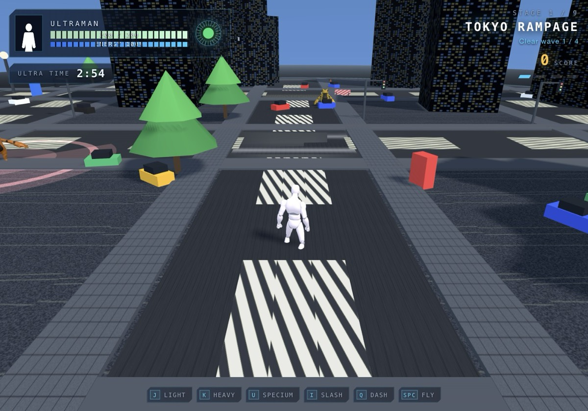
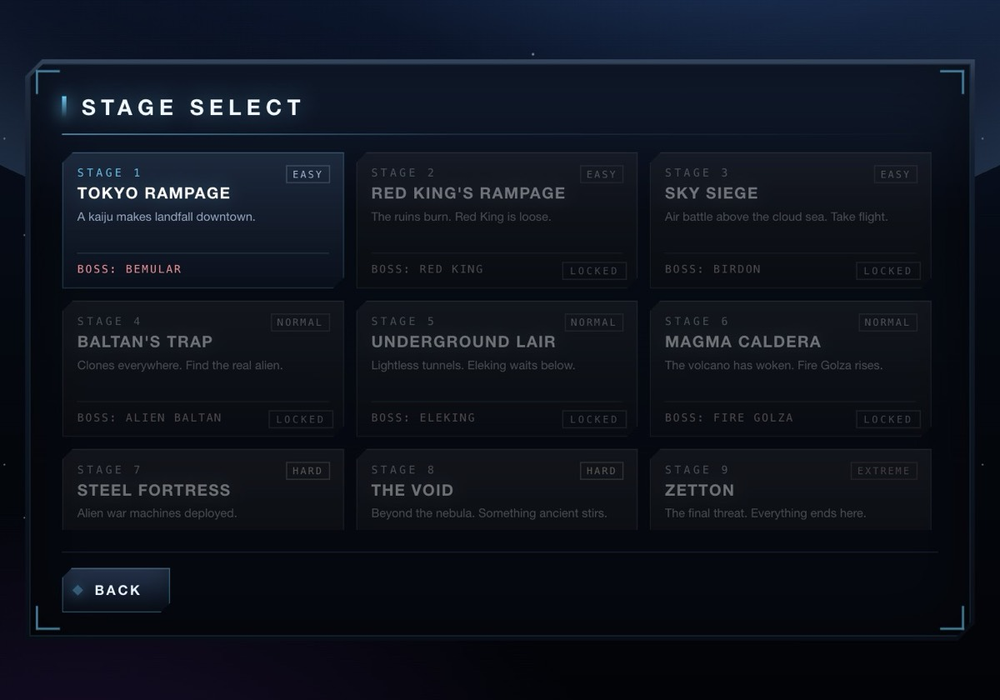

# TOKUSATSU BRAWLER

**A dependency-free three.js engine, level kit and GLB asset pipeline for building
third-person action games where a giant hero fights giant monsters** — the Ultraman /
Godzilla / Super Sentai shape of game.

No build step, no npm, no bundler. `three.js` r128 (UMD) plus plain JavaScript, served
as static files. Everything you see in the world is either a rigged `.glb` you supply
or geometry the engine generates at runtime.

The repo ships as a **complete playable example** — nine stages, nine bosses, combos,
finishers, damage numbers, upgrade picks — with a **100% CC0 art pack**, so
`git clone` → serve → play works out of the box. Every character in that pack is a
deliberate stand-in. Swap in your own models, or download CC0 ones, and follow
[`docs/ASSET-PIPELINE.md`](docs/ASSET-PIPELINE.md).

```
┌──────────────────────────────────────────────────────────────┐
│  hero.glb  ──┐                                               │
│              ├─►  RiggedActor  ──►  AnimationMixer ──► HUD   │
│  anim-ual.glb┘        ▲                                      │
│                       │  shared interface with the 2.5D      │
│  kaiju-*.glb ─────────┘  sprite fallback in sprites.js       │
└──────────────────────────────────────────────────────────────┘
```



<p align="center"><sub>the CC0 stand-in pack running the Tokyo stage — a Universal Rig
mannequin, KayKit/Quaternius monsters, and a level, HUD and every effect below it built
at runtime</sub></p>



## Two builds

This repo ships the same game twice, from the same content tables:

| Build | Runs on | Characters |
|---|---|---|
| [`/`](index.html) — the engine described below | any static server, three.js r128, no build step | rigged skinned `.glb`, loaded at runtime |
| [`roblox/`](roblox/README.md) | Roblox, via [Rojo](https://rojo.space) or a copy-paste | `.glb` baked offline into Luau by [`tools/glb_to_roblox.py`](tools/glb_to_roblox.py), drawn as anchored parts |

Roblox has no runtime glTF loader, so the Roblox build takes a different route to the same
game: the tool bakes a rig and its clips into Luau modules once, `Figure.luau` plays them
by placing parts, and the result ships with no uploads and no asset ids. See
[`docs/ROBLOX.md`](docs/ROBLOX.md) for the reasoning and [`roblox/README.md`](roblox/README.md)
to run it.

## JAGA HUTAN — a second game

[`hutan/`](hutan/README.md) is a smaller game built on the same engine files and model
pack: a third-person forest-fire defence where a burning giant walks the canopy line, an
oil-palm crew plants the ashes, and you fight back with a hose, a sledgehammer and a
water-bombing helicopter.

```bash
open http://localhost:8777/hutan/
```

It has its own HUD, a gold arc main menu, three stages and a difficulty setting. The
characters are two unrigged photogrammetry scans (`wowok`) animated by a vertex-shader
arm droop rather than a skeleton — see [`hutan/README.md`](hutan/README.md).

## Quickstart

```bash
git clone https://github.com/shafry00/tokusatsu-brawler
cd tokusatsu-brawler
python3 -m http.server 8777        # any static server; file:// will not work
open http://localhost:8777/index.html
```

A static file server is required: the game fetches `.glb` models with `fetch()`, and
`file://` blocks that under CORS.

The CC0 pack is ~12 MB, so the first load is quick. The title screen appears once the
hero mesh and its clip library are in.

## Controls

| Key | Action |
|---|---|
| `W A S D` | Move |
| Mouse | Look / aim (pointer lock; click-drag also works) |
| `Shift` | Sprint — **hold in the air to dive** |
| `Space` | Jump — **hold in the air to fly**, release to sink |
| `J` / Left click | Light attack — chains into a 3-hit combo |
| `K` / Right click | Heavy strike — breaks guard |
| `U` | Beam (costs 40 energy) |
| `I` | Piercing slash ring (25 energy) |
| `Q` | Dash (invincible frames) |
| `C` | Lock-on / release camera |
| `G` | Summon an ally (once per stage) |
| `F` | Finisher — only when the prompt appears |
| `M` | Mute |
| `Esc` | Pause |

Touch controls appear on mobile (virtual stick + buttons).

## What's in the box

| Area | What you get |
|---|---|
| **Rendering** | three.js r128 (UMD, vendored). No network at runtime, no CDN, no shims. |
| **Characters** | Rigged skinned GLB driven by `THREE.AnimationMixer`; a 2.5D billboard `Actor` behind the same interface as a fallback |
| **Animation** | Slot-based clip resolution **per rig family** with fallbacks, retiming into the game's wind-up/active/recovery window, speed-matched locomotion, crossfades |
| **Levels** | 9 procedural biomes; a prop system that tags every object with its gameplay properties in `userData`; destructible, solid and camera-occluder behaviour; all textures drawn to canvas at boot |
| **Combat** | Combo chaining, heavy/beam/slash/dash, boss phases, finisher windows, hitstop, slow-mo, screen shake, adaptive resolution |
| **Feedback** | Pooled additive FX: tapered beams, crescents, rings, shock fronts, gathers, impacts, debris, damage numbers |
| **Audio** | 100% procedural WebAudio synthesis — no audio files at all |
| **UI** | Title, stage select, controls, pause, stage clear with power-up picker, game over, victory, in-game HUD |
| **Save** | `localStorage` unlocks + per-stage best score |
| **Mobile** | Virtual stick and buttons |

## Bring your own characters

The engine only ever asks a model for three things, all documented in
[`assets/README.md`](assets/README.md):

1. **A humanoid skeleton with recognisable bone names** (`hips`, `spine`, `chest`,
   `upperarm_l`, `thigh_r`, …) — or a bone map that says what yours are called.
2. **Clips that answer to slot patterns** — `idle`, `walk`, `run`, `jump`, `atk1`,
   `atk2`, `beam`, `hit`, `death`. Missing slots fall back, so a rig with only idle
   and walk still works.
3. **Feet at `y = 0`**, any scale (the loader normalises height) and any facing.

If you have a model that is rigged but animated for a different skeleton, the pipeline
in [`tools/`](tools/README.md) moves the clip set onto it:

```bash
tools/retarget.py --list                          # bone maps that ship as examples
tools/retarget.py --model ~/dl/my-kaiju.glb --map my-bones.json --install
```

That is the flow this project was built around — see
[`docs/ASSET-PIPELINE.md`](docs/ASSET-PIPELINE.md) for the whole route from a
downloaded `.glb` to a character in the game, including the two traps that cost the
most time (rest-pose mismatch, and skinned bounds that lie about size).

For the **Roblox** build the same contract applies to the source `.glb`, but the route is
shorter — the tool bakes the rig and its clips into Luau, so there is no retargeting and
no import step:

```bash
tools/glb_to_roblox.py ~/dl/my-kaiju.glb --report        # what will this cost on Roblox?
tools/glb_to_roblox.py ~/dl/my-kaiju.glb --out roblox/src/shared
```

## Architecture

| File | Role |
|---|---|
| `index.html` | All screens as markup: title, stage select, controls, pause, clear, game over, victory, HUD |
| `css/style.css` | HUD + menu skin (chamfered panels, cyan console readouts) |
| `js/three.min.js` | three.js r128 UMD, vendored |
| `js/lib/GLTFLoader.js` | GLTF loader (vendored from r128) |
| `js/lib/SkeletonUtils.js` | Skinned-mesh clone helper (vendored from r128) |
| `js/audio.js` | `Audio2` — procedural SFX and music beds |
| `js/fx.js` | `FX` — pooled particles, rings, shocks, beams, crescents, gathers, impacts, hitstop, shake, damage numbers |
| `js/sprites.js` | `Sprites` + `Actor` — 2.5D billboards, and the procedural stand-in silhouettes |
| `js/models.js` | `Models` + `RiggedActor` — GLB loading, per-role colouring, the animation slot system |
| `js/world.js` | `World.STAGES` (9 configs), procedural biomes, prop system, `World.collide` |
| `js/enemies.js` | `SPECIES` table, attack library, boss patterns, AI state machine |
| `js/player.js` | Movement, flight, aim, combo, heavy, beam, slash, dash, finisher |
| `js/game.js` | Orchestrator: camera, input, waves, bosses, pickups, allies, HUD, occluder fade |
| `assets/models/` | The CC0 example pack + the asset contract |
| `tools/` | The asset pipeline: retargeting, clip realignment, inspection |
| `roblox/` | The same game for Roblox: Luau modules, Rojo project, baked rig |
| `docs/` | Everything below |

Deeper dives:

* [`docs/ARCHITECTURE.md`](docs/ARCHITECTURE.md) — how the modules fit together, the actor abstraction, the update loop
* [`docs/ASSET-PIPELINE.md`](docs/ASSET-PIPELINE.md) — downloaded `.glb` → playable character
* [`docs/ROBLOX.md`](docs/ROBLOX.md) — the Roblox build: baking a `.glb` into Luau, Roblox's import budgets, why there is no `Motor6D`, and what is and is not Studio-tested
* [`docs/CONTENT.md`](docs/CONTENT.md) — reskin this example into your own game, file by file
* [`docs/LEVELS.md`](docs/LEVELS.md) — the stage config, the prop system, adding a biome
* [`docs/FX.md`](docs/FX.md) — the effect API and recipes that read well in third person
* [`docs/SPRITES.md`](docs/SPRITES.md) — the 2.5D fallback and the procedural silhouettes
* [`docs/DEPLOY.md`](docs/DEPLOY.md) — shipping it (Cloudflare Pages walkthrough included)

## The example content

The game that ships here is a fan project about a silver giant and nine monsters. It is
content-agnostic engine code wearing one particular hat: every name, colour, stage and
stat lives in a handful of tables (`HERO` and `KAIJU` in `js/models.js`, `SPECIES` in
`js/enemies.js`, `STAGES` in `js/world.js`, plus the strings in `index.html`).
[`docs/CONTENT.md`](docs/CONTENT.md) lists them all with line references.

## Licence

* **Code:** [MIT](LICENSE) — use it commercially, no strings.
* **Example art pack (`assets/models/`):** CC0 / public domain. See
  [`CREDITS.md`](CREDITS.md) for the per-file attribution.
* **The Roblox build (`roblox/`):** the same MIT code, plus generated Luau
  (`Rig.luau`, `clips/`) baked from the CC0 mannequin in the example pack. Nothing in it
  needs uploading, and no asset ids are baked in.
* Ultraman and related characters are trademarks of Tsuburaya Productions. This is an
  unofficial, non-commercial fan project and is not affiliated with or endorsed by
  them. If you build on this, **replace the example names and any character-derived
  art with your own** — that is what the engine is for.
